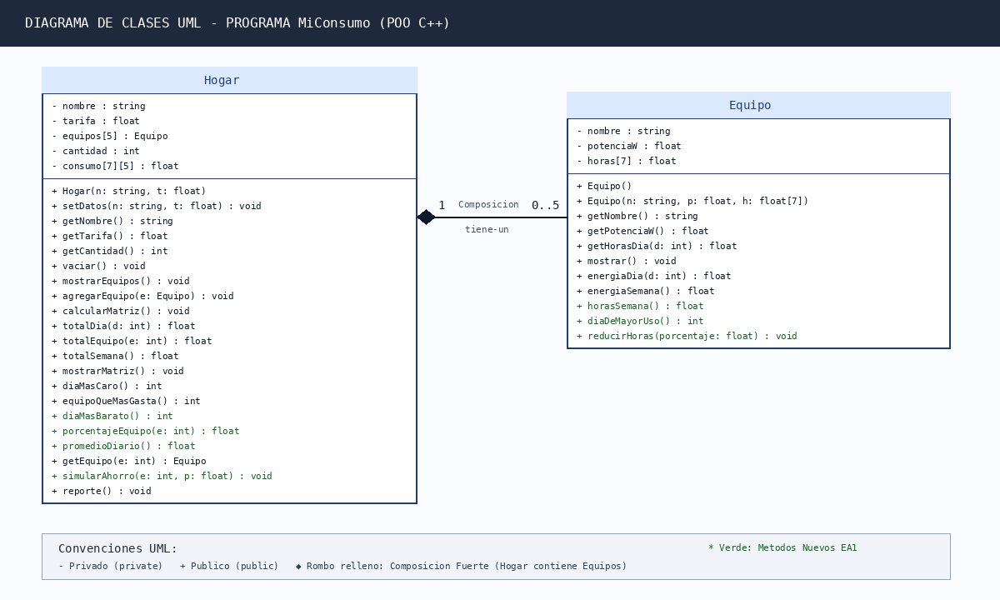

# MiConsumo - Cálculo y Simulación de Ahorro Energético (C++ POO)

> **Programa:** Ingeniería de Software y Datos  
> **Asignatura:** Programación Orientada a Objetos (PREICA2602B020043)  
> **Institución:** Institución Universitaria Digital de Antioquia (IU Digital)  
> **Estudiante:** Jorge Alejandro Rubio Giraldo  
> **Docente:** Carlos Arturo Castro Castro  
> **Año:** 2026-2

---

## 📌 Descripción del Proyecto

`MiConsumo` es un programa orientado a objetos desarrollado en **C++** que modela, calcula y simula el consumo y costo de la energía eléctrica de una vivienda familiar durante una semana, frente a la coyuntura del alza tarifaria provocada por el fenómeno de **El Niño 2026** y el esquema sancionatorio de la **Resolución CREG 101 120**.

El programa utiliza:
* **Clases con encapsulamiento:** Atributos privados (`-`) y métodos públicos (`+`).
* **Vector unidimensional:** Almacenamiento de horas diarias de uso (7 días).
* **Vector de objetos:** Gestión de una colección de electrodomésticos en la clase `Hogar`.
* **Matriz bidimensional:** Registro del consumo diario en kWh de cada equipo (7 filas × 5 columnas).
* **Simulación interactiva:** Algoritmo de reducción horaria y cuantificación de ahorros antes/después en pesos colombianos (COP).

---

## 📊 Datos Reales del Hogar y Factura

* **Tarifa Real de Energía:** `$ 960.34 COP / kWh` (según extracto oficial de servicios públicos).
* **Meta Regulatoria CREG:** `136.64 kWh/mes` (Consumo real registrado en el mes: `153.00 kWh`).
* **Equipos Eléctricos Modelados (5 equipos):**
  1. **Nevera LG Side by Side 519L (GS51BPP):** Potencia media efectiva de 54 W (etiqueta RETIQ: 38.9 kWh/mes), 24 h/día los 7 días.
  2. **Smart TV LG 75" UHD 4K (ThinQ):** Potencia de 230 W, 6 h/día (lun-vie) y 10 h/día (sáb-dom).
  3. **Lavadora Samsung EcoBubble:** Potencia ciclo 500 W, dos ciclos semanales de 35 min (0.58 h).
  4. **Computador Mac Mini:** Potencia de 50 W, 6 h/día (lun-vie) y 2 h (sábado).
  5. **Freidora de Aire Black & Decker:** Potencia de 1500 W, 15 min diarios (0.25 h/día).

---

## 🏗️ Diagrama de Clases UML



### Métodos Nuevos Implementados (Evidencia 1)
* **Clase `Equipo`:**
  * `horasSemana()`: Devuelve el total acumulado de horas en la semana.
  * `diaDeMayorUso()`: Retorna el índice del día con mayor tiempo de uso.
  * `reducirHoras(float porcentaje)`: Reduce las horas diarias en el porcentaje indicado.
* **Clase `Hogar`:**
  * `diaMasBarato()`: Retorna el índice del día con menor consumo en kWh.
  * `porcentajeEquipo(int e)`: Calcula qué porcentaje del consumo total representa el equipo $e$.
  * `promedioDiario()`: Retorna el promedio diario de consumo en kWh.
  * `simularAhorro(int e, float porcentaje)`: Aplica reducción, recalcula la matriz y muestra costos antes, después y ahorro en COP.

---

## 🚀 Compilación y Ejecución

### Requisitos
* Compilador **g++** compatible con C++17 (MSYS2 / MinGW-w64 en Windows o GCC en Linux).
* Visual Studio Code o terminal estándar.

### Compilar desde la terminal:
```bash
g++ -Wall -Wextra -std=c++17 miconsumo.cpp -o miconsumo
```

### Ejecutar:
```bash
./miconsumo        # En Linux/macOS
.\miconsumo.exe    # En Windows PowerShell / CMD
```

---

## 📸 Menú y Pruebas de Ejecución

El programa cuenta con un menú interactivo con validaciones robustas contra datos negativos o fuera de rango:

```text
============================================================
         SISTEMA DE GESTION ENERGETICA - MiConsumo          
============================================================
1. Ingresar datos de la casa (Nombre y Tarifa)
2. Agregar un equipo manualmente
3. Ver lista de equipos registrados
4. Ver matriz de consumo semanal (kWh)
5. Ver reporte completo y proyeccion mensual
6. Cargar datos reales de mi casa (5 equipos - Factura EPM)
7. Simular un ahorro energetico en un equipo
8. Ver detalle y estadisticas de un equipo
0. Salir
------------------------------------------------------------
```

### Resultados de la Simulación de Ahorro:
* **Equipo modificado:** Smart TV LG 75" (Reducción del 20 % en tiempo de uso).
* **Consumo Semanal:** Pasa de `25.38 kWh` a `23.08 kWh` (-2.30 kWh).
* **Ahorro Semanal Estimado:** `$ 2,209 COP`.
* **Ahorro Mensual Estimado:** `$ 8,835 COP`.

---

## 📁 Estructura del Proyecto

```text
miConsumoCpp/
├── miconsumo.cpp                                                      # Código fuente C++ completo
├── miconsumo                                                          # Binario compilado
├── Rubio_Jorge_EA1_Programa_orientado_a_objetos_con_vectores_y_matrices.pdf  # Documento formal de entrega
├── factura_energia_recorte.png                                        # Recorte anónimo de la factura
├── etiqueta_nevera.png                                                # Etiqueta RETIQ Nevera LG
├── etiqueta_tv_lg.png                                                 # Panel Smart TV LG 75"
├── diagrama_clases_uml.png                                            # Diagrama de Clases UML
├── captura1_validacion.png                                            # Prueba 1: Rechazo datos inválidos
├── captura2_matriz.png                                                # Prueba 2: Matriz semanal
├── captura3_reporte.png                                               # Prueba 3: Reporte energético
├── captura4_simulacion.png                                            # Prueba 4: Simulación de ahorro
├── captura5_equipo.png                                                # Prueba 5: Ficha técnica equipo
└── README.md                                                          # Documentación del repositorio
```

---

## 📜 Licencia
Proyecto académico de código abierto bajo licencia MIT. Desarrollado con fines educativos para la **IU Digital de Antioquia**.
